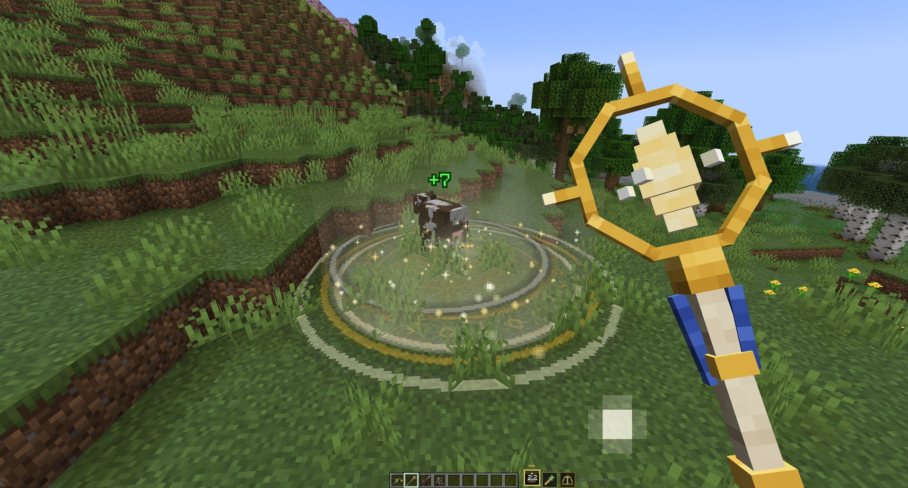

<p align="center">
  
</p>

<h1 align="center">Holy Staff</h1>

<p align="center">
  <b>A blessed staff for healers</b> - three healing skills on one button, light effects, sounds and green numbers that show exactly how much you healed.
</p>

<p align="center">
  <a href="https://www.curseforge.com/minecraft/mc-mods/holy-staff"></a>
  <a href="https://www.minecraft.net"></a>
  <a href="https://neoforged.net"></a>
  <a href="https://www.curseforge.com/minecraft/mc-mods/geckolib"></a>
  <a href="LICENSE"></a>
</p>

<p align="center">
  
</p>

## Features

### Skills

Cast with **right click**, switch with **left click** or **sneak + mouse wheel**.

- 🟡 **Blessed Ground** - place a rune circle with an aim preview; light fills it and heals everyone inside. Cooldown
  3 s.
- 🔆 **Holy Beam** - a beam locks onto an ally and heals it strongly for 3 s while you walk slowly. Cooldown 10 s.
- ⛪ **Sanctuary** - plant the staff: enemies are thrown back and a dome of light heals allies in pulses. Cooldown 20 s.

### More

- 🪄 **Animated 3D staff**, taller than the player, with a glowing crystal and casting poses.
- 💚 **Flying heal numbers**; your own heals appear next to your health bar.
- ⏱️ **Skill bar** with cooldowns and a cast bar.
- 🐺 **Heals the right ones** - players, pets, animals, villagers and golems, never hostile mobs or anything attacking a
  player (configurable).
- 💀 **Holy light burns the undead** - every skill hurts zombies, skeletons, phantoms and other undead instead of
  healing them, with golden damage numbers; undead pets are still healed.
- 💗 **Creative Holy Staff** - no cooldowns, double healing, twice the beam range.
- ⚙️ **Every number is configurable.**

## Controls

| Input | Action |
|---|---|
| Right click | Cast the selected skill |
| Left click / sneak + mouse wheel | Switch skill (an extra key can be bound in Controls) |
| Left or right click during Holy Beam | Cancel the beam |

| Skill | Default effect | Cooldown |
|---|---|---|
| Blessed Ground | heal 7 to everyone in radius 3 after 0.6 s | 3 s |
| Holy Beam | 8 health per second for 3 s on one ally | 10 s |
| Sanctuary | knockback, 6 pulses of 2.5 health in radius 7 | 20 s |

## Crafting

```
 . G A
 . B G
 B . .
```

`A` Golden Apple, `G` Gold Ingot, `B` Blaze Rod. The recipe unlocks when you get a golden apple.
In creative mode the staff and the Creative Holy Staff are in the **Pocky Mods** tab and in **Combat**.

## Configuration

`config/holy_staff-common.toml` (also in the in-game config screen):

| Option | Default | Description |
|---|---|---|
| `healMonsters` | `false` | Whether hostile mobs (monsters and mobs attacking players or their pets) can be healed |
| `holyDamage` / `holyDamageMultiplier` | `true` / `1.0` | Whether skills hurt undead mobs instead of healing them, and how much (x the heal) |
| `blessedGround.amount` / `radius` / `delay` / `range` / `cooldown` | `7` / `3` / `0.6` s / `20` / `3` s | Blessed Ground |
| `holyBeam.healPerSecond` / `duration` / `range` / `movementMultiplier` / `cooldown` | `8` / `3` s / `16` / `0.3` / `10` s | Holy Beam |
| `sanctuary.healPerPulse` / `pulseInterval` / `duration` / `radius` / `knockbackRadius` / `knockbackStrength` / `cooldown` | `2.5` / `0.5` s / `3` s / `7` / `5` / `1.5` / `20` s | Sanctuary |

`config/holy_staff-client.toml`: `showHealNumbers`, `showSkillHud`.

## Installation

1. Install [NeoForge](https://neoforged.net) for Minecraft 1.21.1.
2. Install [GeckoLib](https://www.curseforge.com/minecraft/mc-mods/geckolib) 4.9 or newer.
3. Put this mod into the `mods` folder (on the client and on the server).

## Building

```sh
./gradlew build
```

The jar is written to `build/libs/`.

## Credits

- Author: **Pocky**.
- Model, textures and particles: made for this mod.
- Sounds: made for this mod from CC0 sources: [Cure Magic](https://opengameart.org/content/cure-magic) by Someoneman
  (OpenGameArt) and the [Kenney](https://kenney.nl) Sci-Fi, Impact and Interface sound packs, layered with
  synthesized chords.
- Animated model rendering: [GeckoLib](https://github.com/bernie-g/geckolib).

<!-- more-mods:start -->
## More mods by Pocky

**🌦️ Weather & nature**

<table>
  <tr>
    <td width="56"><a href="https://www.curseforge.com/minecraft/mc-mods/hoarfrost-snow-blizzards"></a></td>
    <td><a href="https://www.curseforge.com/minecraft/mc-mods/hoarfrost-snow-blizzards"><b>Hoarfrost: Snow & Blizzards</b></a> - seven kinds of snowfall, a living wind and soft snow on the land (<a href="https://github.com/Pocky-l/hoarfrost">source</a>)</td>
  </tr>
  <tr>
    <td width="56"><a href="https://www.curseforge.com/minecraft/mc-mods/petrichor-rain-storms"></a></td>
    <td><a href="https://www.curseforge.com/minecraft/mc-mods/petrichor-rain-storms"><b>Petrichor: Rain & Storms</b></a> - realistic rain, puddles, drips and branching lightning (<a href="https://github.com/Pocky-l/petrichor">source</a>)</td>
  </tr>
  <tr>
    <td width="56"><a href="https://www.curseforge.com/minecraft/mc-mods/rustling-leaves"></a></td>
    <td><a href="https://www.curseforge.com/minecraft/mc-mods/rustling-leaves"><b>Rustling Leaves</b></a> - falling leaves and leaf piles you can wade through, rake and blow away (<a href="https://github.com/Pocky-l/rustling-leaves">source</a>)</td>
  </tr>
</table>

**💡 Light**

<table>
  <tr>
    <td width="56"><a href="https://www.curseforge.com/minecraft/mc-mods/lumen-rigs"></a></td>
    <td><a href="https://www.curseforge.com/minecraft/mc-mods/lumen-rigs"><b>Lumen Rigs</b></a> - aimable spotlights and floodlights with colored light and visible beams (<a href="https://github.com/Pocky-l/lumen-rigs">source</a>)</td>
  </tr>
  <tr>
    <td width="56"><a href="https://www.curseforge.com/minecraft/mc-mods/neon-glowsticks"></a></td>
    <td><a href="https://www.curseforge.com/minecraft/mc-mods/neon-glowsticks"><b>Neon Glowsticks</b></a> - throwable glowsticks that bounce, roll and light up the dark (<a href="https://github.com/Pocky-l/neon-glowsticks">source</a>)</td>
  </tr>
</table>

**🎨 Graphics & performance**

<table>
  <tr>
    <td width="56"><a href="https://www.curseforge.com/minecraft/mc-mods/turbo-for-distant-horizons"></a></td>
    <td><a href="https://www.curseforge.com/minecraft/mc-mods/turbo-for-distant-horizons"><b>Turbo for Distant Horizons</b></a> - Distant Horizons terrain generated many times faster (<a href="https://github.com/Pocky-l/dhturbo">source</a>)</td>
  </tr>
  <tr>
    <td width="56"><a href="https://www.curseforge.com/minecraft/mc-mods/pocky-shaders"></a></td>
    <td><a href="https://www.curseforge.com/minecraft/mc-mods/pocky-shaders"><b>Pocky Shaders</b></a> - a cosy, natural shader pack that sets itself up (<a href="https://github.com/Pocky-l/pocky-shaders">source</a>)</td>
  </tr>
</table>

**⚔️ Gear & gameplay**

<table>
  <tr>
    <td width="56"><a href="https://www.curseforge.com/minecraft/mc-mods/ranchers-vacpack"></a></td>
    <td><a href="https://www.curseforge.com/minecraft/mc-mods/ranchers-vacpack"><b>Rancher's Vacpack</b></a> - a Slime Rancher vacuum gun for items and small mobs (<a href="https://github.com/Pocky-l/ranchers-vacpack">source</a>)</td>
  </tr>
</table>

**🛠️ Server tools**

<table>
  <tr>
    <td width="56"><a href="https://www.curseforge.com/minecraft/mc-mods/inventory-backups"></a></td>
    <td><a href="https://www.curseforge.com/minecraft/mc-mods/inventory-backups"><b>Inventory Backups</b></a> - inventory and ender chest backups with one-click restore for admins (<a href="https://github.com/Pocky-l/inventory-backups">source</a>)</td>
  </tr>
</table>

<!-- more-mods:end -->

## License

[MIT](LICENSE)
